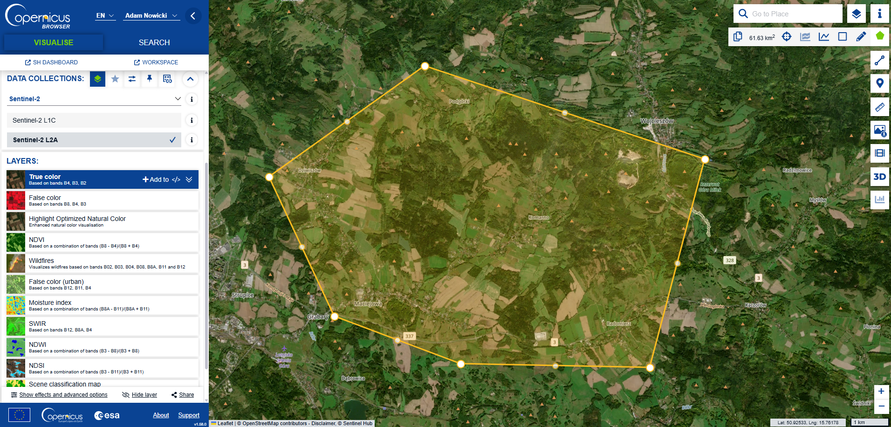
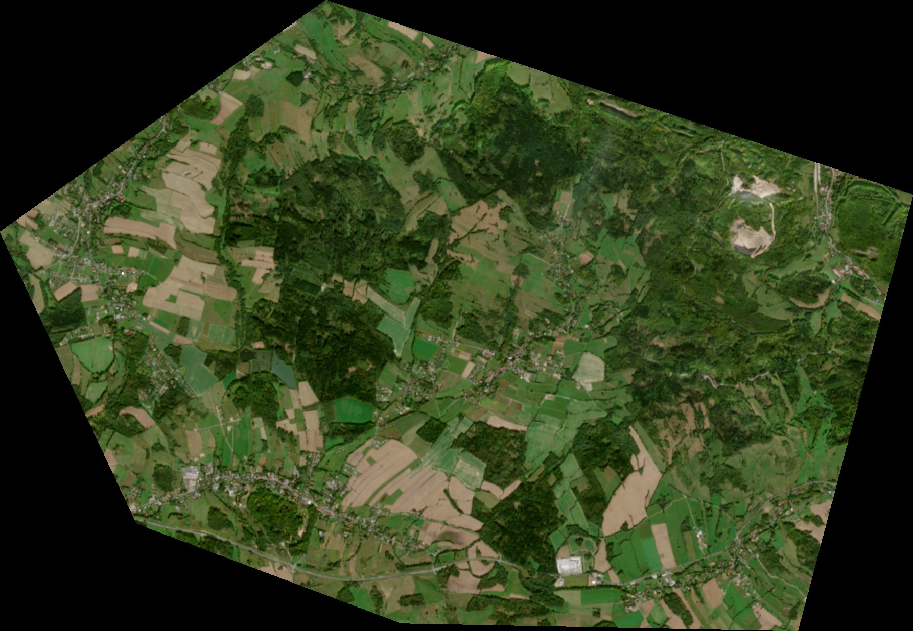
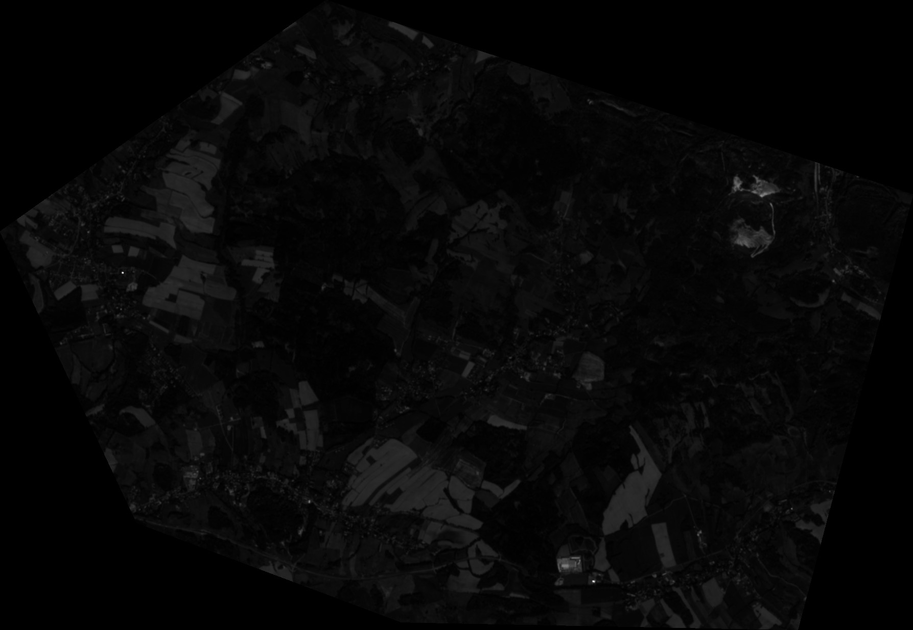
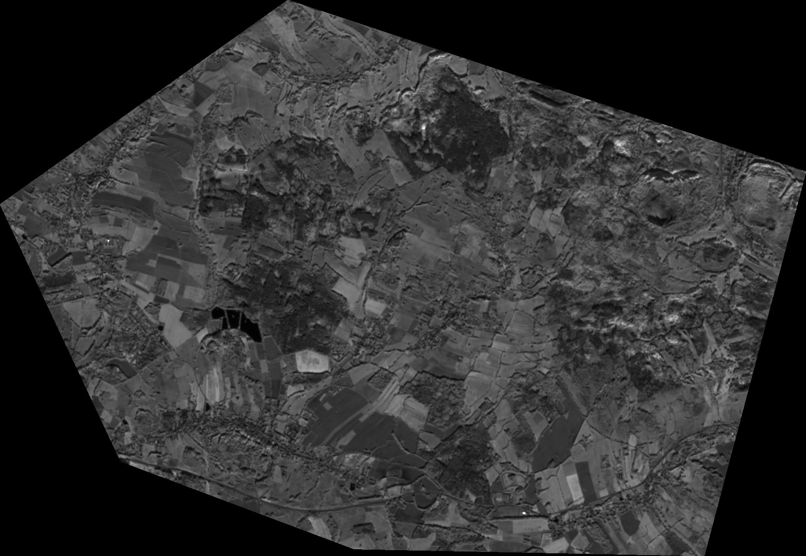
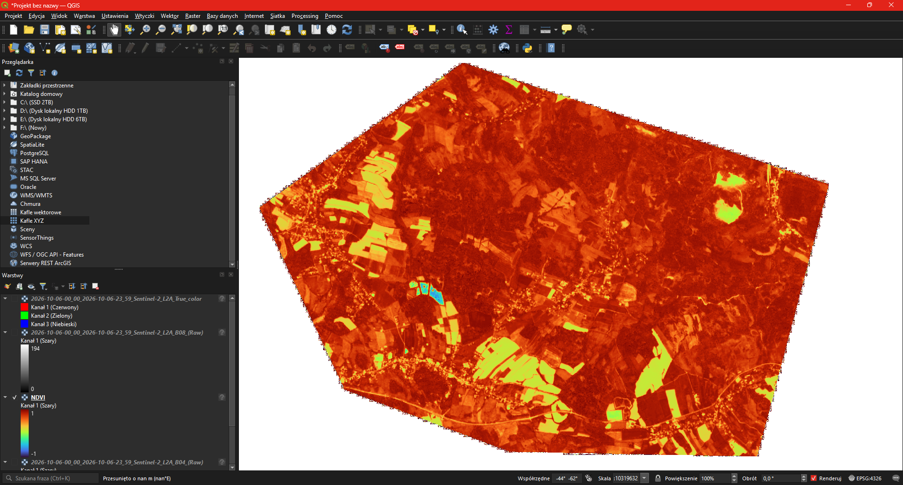

# NDVI z danych Sentinel-2 w QGIS – okolice Jeleniej Góry

**Autor:** Adam Nowicki · **Nr indeksu:** 109627 · **Data:** 10.10.2026

## Cel

Obliczenie wskaźnika wegetacji NDVI z kanałów B04 (czerwony) i B08 (bliska podczerwień) satelity Sentinel-2.

## Obszar i dane

- **Obszar:** ok. 61,6 km² na północny wschód od Jeleniej Góry, obejmujący wsie Komarno, Radomierz i Maciejowa
- **Dane:** Sentinel-2 L2A z 06.10.2026, pobrane z [Copernicus Browser](https://browser.dataspace.copernicus.eu/)



| True color | B04 – czerwony | B08 – NIR |
|---|---|---|
|  |  |  |

## Wykonanie

1. Zaznaczyłem obszar w Copernicus Browser i pobrałem kanały B04 i B08.
2. Otworzyłem oba kanały w QGIS.
3. W **Raster → Kalkulator rastra** obliczyłem NDVI:

   ```
   ("B08@1" - "B04@1") / ("B08@1" + "B04@1")
   ```

4. Wynikowi nadałem symbolizację pseudokolor w zakresie −1…1.

## Wynik



- **Ciemnoczerwony** (wysokie NDVI) to lasy i łąki z gęstą roślinnością.
- **Żółty i zielony** (niskie NDVI) to pola po zbiorach, zabudowa wsi i drogi.
- **Niebieski** (NDVI < 0) to woda, czyli stawy w zachodniej części obszaru.

Mapa NDVI zgadza się z obrazem w barwach naturalnych: tereny zalesione wyraźnie odróżniają się od pól uprawnych i zabudowy.
