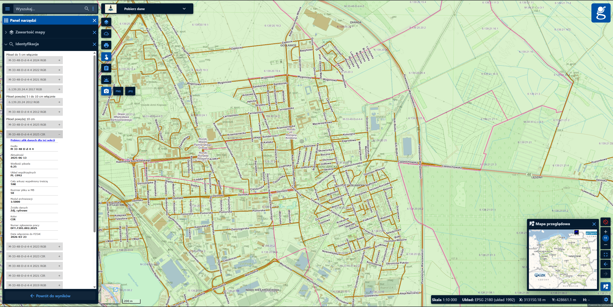
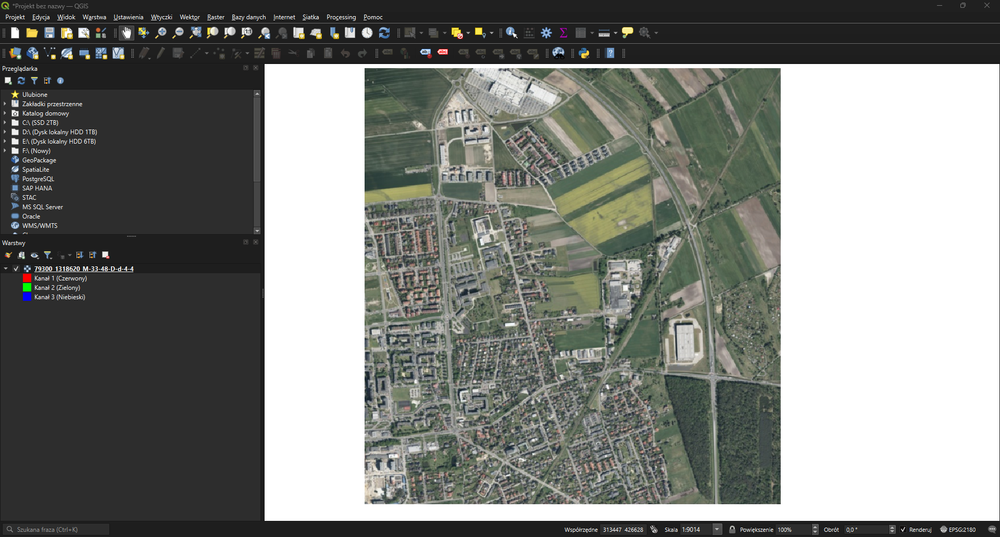
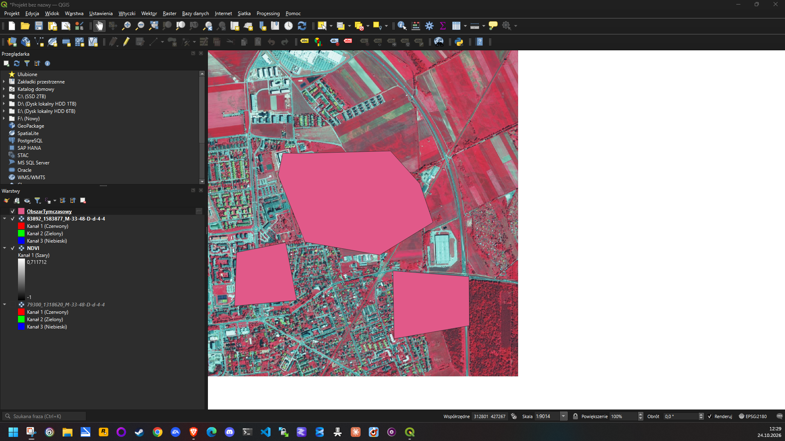
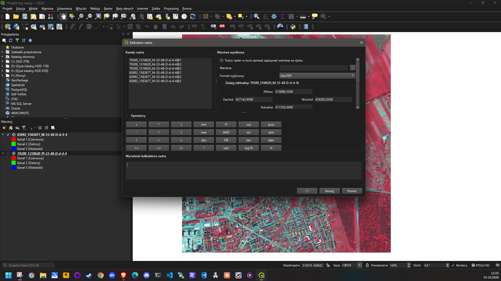
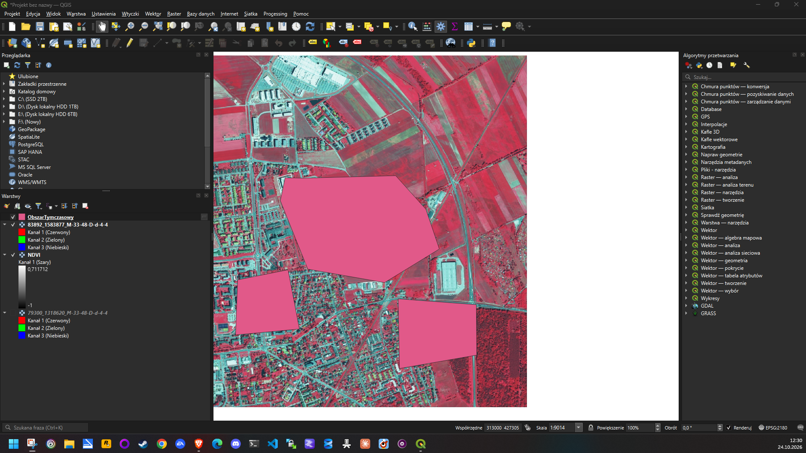
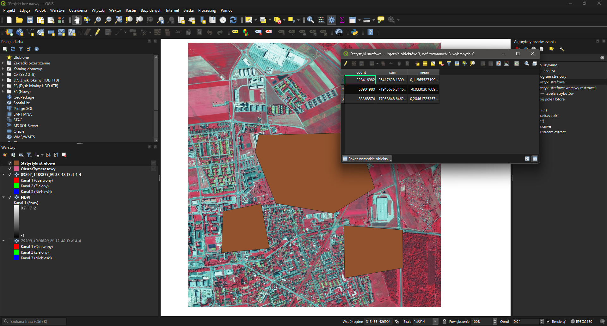
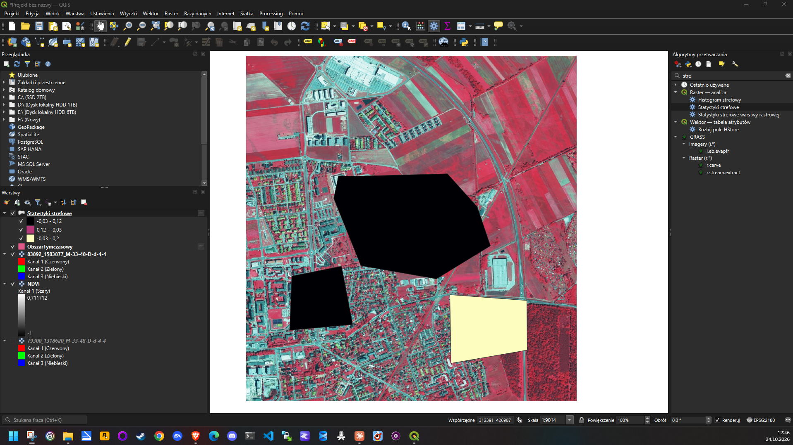

# NDVI z ortofotomapy CIR w QGIS – Opole, Gosławice

**Autor:** Adam Nowicki · **Nr indeksu:** 109627 · **Data:** 24.10.2026

## Cel

Obliczenie NDVI z wysokorozdzielczej ortofotomapy CIR oraz statystyk strefowych NDVI dla wybranych obszarów.

## Obszar i dane

- **Obszar:** północno-wschodnia część Opola (Gosławice, Zaodrze)
- **Dane:** z [Geoportalu](https://www.geoportal.gov.pl/) (Pobierz dane → Ortofotomapa → Ortofotomapa wg rozdzielczości), arkusz **M-33-48-D-d-4-4**:
  - **2025 CIR** – zdjęcie z 13.06.2025, piksel 0,25 m, układ PL-1992 (EPSG:2180)
  - 2025 RGB – do porównania z barwami naturalnymi



| RGB – barwy naturalne | CIR – roślinność na czerwono |
|---|---|
|  |  |

## Wykonanie

1. Pobrałem z Geoportalu arkusze CIR i RGB i otworzyłem je w QGIS.
2. W **Raster → Kalkulator rastra** obliczyłem NDVI z warstwy CIR (kanał 1 = NIR, kanał 2 = R):

   ```
   ("83892_1583877_M-33-48-D-d-4-4@1" - "83892_1583877_M-33-48-D-d-4-4@2")
   / ("83892_1583877_M-33-48-D-d-4-4@1" + "83892_1583877_M-33-48-D-d-4-4@2")
   ```

   

   Wynik zapisałem jako `NDVI.tif` (zakres wartości od −1 do 0,71).
3. Utworzyłem warstwę tymczasową `ObszarTymczasowy` i narysowałem na niej 3 poligony.

   

4. W **Processing Toolbox → Raster – analiza → Statystyki strefowe** policzyłem statystyki NDVI dla każdego poligonu.

## Wynik



| Poligon | Charakter terenu | Liczba pikseli | Średnie NDVI |
|---|---|---|---|
| 1 – środkowy, duży | osiedle z terenami zielonymi i nieużytkami | 228 416 982 | **0,116** |
| 2 – południowo-zachodni | zwarta zabudowa mieszkaniowa | 58 904 980 | **−0,033** |
| 3 – południowo-wschodni | zabudowa jednorodzinna z ogrodami przy lesie | 83 368 574 | **0,205** |



- Najwyższe średnie NDVI ma poligon 3, z największym udziałem ogrodów i zadrzewień.
- Najniższe (ujemne) ma poligon 2, gdzie dominują dachy, drogi i parkingi.
- Wszystkie średnie są niskie, bo każdy poligon obejmuje teren zabudowany; wysokie NDVI (do 0,71) występuje na polach i w lesie poza poligonami.

Wyniki zgadzają się z obrazem CIR: im więcej czerwieni w poligonie, tym wyższe średnie NDVI.
