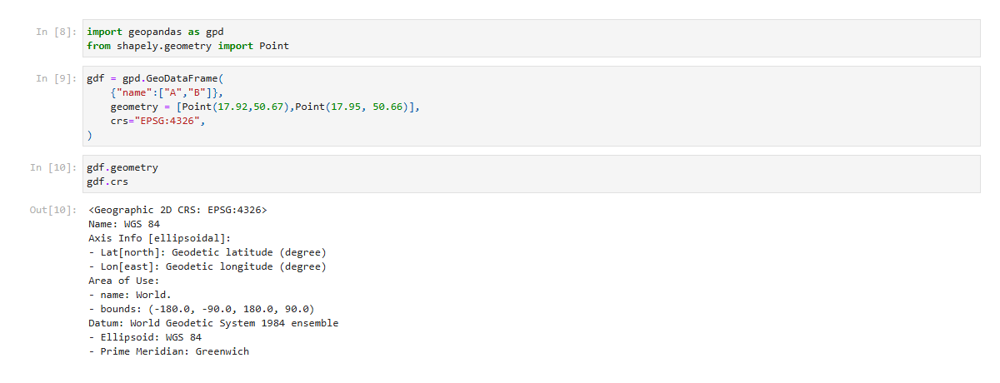
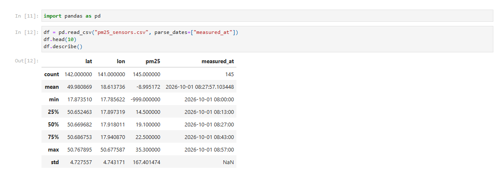
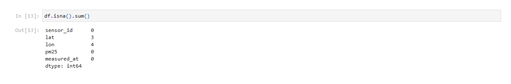
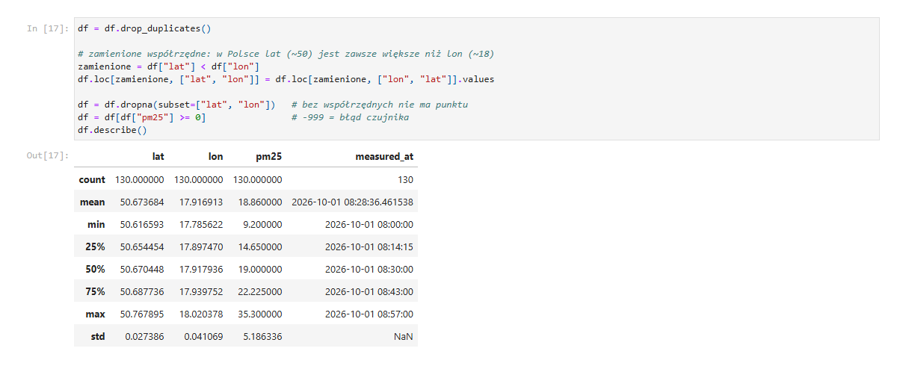
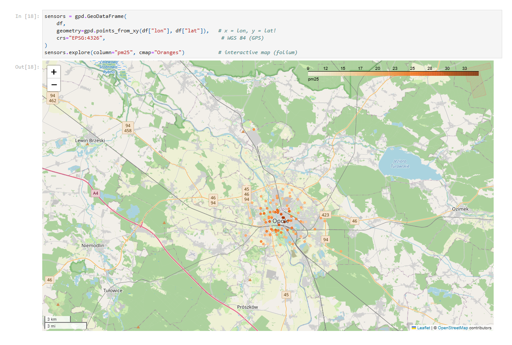

# GeoPandas – czyszczenie danych PM2.5 z czujników w Opolu (część A)

**Autor:** Adam Nowicki · **Nr indeksu:** 109627 · **Data:** 24.10.2026

## Cel

Wczytanie, oczyszczenie i zamiana na dane przestrzenne odczytów PM2.5 z czujników w Opolu (plik CSV z celowymi błędami).

## Dane i środowisko

- **Dane:** `pm25_sensors.csv` – 145 odczytów, kolumny `sensor_id`, `lat`, `lon`, `pm25`, `measured_at`
- **Środowisko:** Python 3.11, GeoPandas 1.2, Jupyter

## Wykonanie

### A1. GeoDataFrame od zera

Utworzyłem GeoDataFrame z dwóch punktów (`shapely.Point`) w układzie **EPSG:4326** (WGS 84, długość i szerokość w stopniach).

### A2. Wczytanie i przegląd danych

Wczytałem CSV przez `pandas.read_csv` i sprawdziłem statystyki oraz braki.

Znalezione problemy:

| Problem | Liczba wierszy |
|---|---|
| duplikaty | 5 |
| brak `lat` / brak `lon` | 3 / 4 |
| zamienione `lat` i `lon` (min `lat` ≈ 17,87) | 3 |
| `pm25 = -999` (kod błędu czujnika) | 4 |

### A3. Czyszczenie

1. Usunąłem duplikaty (`drop_duplicates`).
2. Zamieniłem z powrotem współrzędne tam, gdzie `lat < lon` (w Polsce szerokość ok. 50° jest zawsze większa od długości ok. 18°). Użyłem `.values`, bo bez tego pandas dopasowuje kolumny po nazwach i nic się nie zamienia.
3. Usunąłem wiersze bez współrzędnych (`dropna`).
4. Usunąłem odczyty `pm25 < 0`.

**145 → 140 → 134 → 130 wierszy.** Po czyszczeniu `lat` mieści się w zakresie 50,62–50,77, a `pm25` w zakresie 9,2–35,3 µg/m³.

### A4. Z tabeli do GeoDataFrame

Punkty utworzyłem przez `gpd.points_from_xy(df["lon"], df["lat"])` w układzie EPSG:4326. Zasięg (`total_bounds`) to [17,79; 50,62; 18,02; 50,77], a wszystkie czujniki leżą w Opolu.

## Odpowiedzi na pytania

- **Skąd min `lat` ≈ 17,9?** Trzy wiersze mają zamienione współrzędne: w kolumnie `lat` jest długość geograficzna Opola.
- **Dlaczego zamienione wiersze naprawiamy, a -999 usuwamy?** Zamienione wiersze mają prawdziwy pomiar i da się je odzyskać. -999 to kod błędu bez żadnej wartości; zostawiony zaniżyłby średnią PM2.5 do −9,0.
- **Co, jeśli zamienić `points_from_xy(lat, lon)`?** Punkty trafiają na ok. 50,7°E i 18°N, czyli na Półwysep Arabski. Błędu nie ma, bo obie liczby są poprawnymi współrzędnymi.

## Wnioski

Po usunięciu 15 błędnych wierszy zostało 130 poprawnych odczytów, które leżą w granicach Opola i są gotowe do analizy przestrzennej w dalszej części zajęć.
